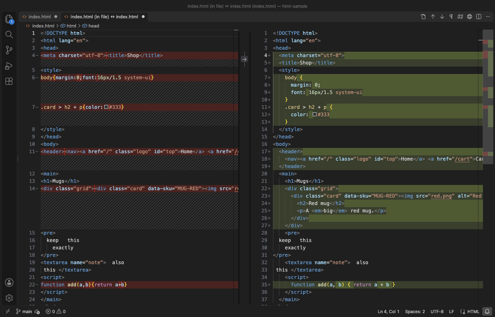

# HTML Formatter & CSS Formatter

HTML formatter and CSS formatter for VS Code, by Zovo. Format HTML, CSS, SCSS and LESS files, and the `<style>` and `<script>` blocks inside a page, with zero config. It follows your `.editorconfig`, keeps `<pre>`, `<textarea>` and inline tags as written, and never reorders attributes. Everything runs offline with the bundled js-beautify, so there is no Node, npm or config file to set up.

## Free, with no sign-in and no network

- Format Document (Shift+Alt+F, Shift+Option+F on macOS) and Format Selection for HTML, CSS, SCSS and LESS.
- Formats the CSS in `<style>` and the JavaScript in `<script>` inside HTML.
- Zero config: uses the editor's indentation, then `.editorconfig` (indent style and size, end of line, final newline, max line length).
- Keeps what you wrote: the contents of `<pre>` and `<textarea>`, inline tags on their line, attribute order, the blank lines between blocks (at most one in a row), the head and body indentation style of the page, and template tags such as `{{ }}` and ``.
- In SCSS and LESS, multi-line maps and function calls keep their layout, and trailing comments stay on their line.
- Format on save: turn on `zovoHtmlFormat.formatOnSave`, or run "Use as Default Formatter" and VS Code's own `editor.formatOnSave`.

## Pro tools

Zovo Pro: USD 19 once, for the Pro tools of every Zovo extension. Each tool has 3 free tries first, with no account.

- Format a folder with a diff preview: formats every HTML, CSS, SCSS and LESS file of a folder in memory, shows the changed files with a side-by-side diff for each, and writes only the files you keep checked.
- Minify HTML and CSS: writes `.min.html` and `.min.css` copies (or into a folder you set), with a report of the bytes and gzip bytes saved per file. Your source files stay as they are.
- HTML lint report: images without alt text, form fields without a label, duplicate ids, skipped heading levels, links and buttons without text, iframes without a title, pages without lang or title, and obsolete tags. A Markdown report, and the same findings in the Problems panel.

Right-click a folder or a file in the Explorer for the Pro tools, or use the editor right-click menu of an HTML or CSS file.

## How to use

1. Open an HTML, CSS, SCSS or LESS file and run Format Document. If VS Code asks which formatter to use, pick HTML Formatter & CSS Formatter.
2. To make it the default for these four languages in one step, run "HTML Formatter: Use as Default Formatter for HTML, CSS, SCSS and LESS" from the command palette.
3. Select some lines and run Format Selection to format only those.

## Settings

| Setting | Default | What it does |
| --- | --- | --- |
| `zovoHtmlFormat.formatOnSave` | `false` | Format with this formatter on every save. |
| `zovoHtmlFormat.useEditorConfig` | `true` | Read `.editorconfig`. |
| `zovoHtmlFormat.wrapLineLength` | `0` | Wrap long lines; 0 keeps them, unless `.editorconfig` sets `max_line_length`. |
| `zovoHtmlFormat.wrapAttributes` | `auto` | How attributes wrap: auto, force, force-aligned, preserve and more. |
| `zovoHtmlFormat.indentInnerHtml` | `auto` | Indent `<head>` and `<body>` under `<html>`; auto keeps the page's style. |
| `zovoHtmlFormat.maxPreserveNewlines` | `2` | Line breaks kept in a row (2 keeps one blank line). |
| `zovoHtmlFormat.newlineBetweenRules` | `false` | Add a blank line between CSS rules. |
| `zovoHtmlFormat.selectorSeparatorNewline` | `false` | One selector per line in `a, b, c`. |
| `zovoHtmlFormat.contentUnformatted` | `[]` | More tags whose content stays as written. |

## Privacy

The extension reads and writes files on your computer and nothing else. It makes no network requests and has no telemetry. js-beautify 1.15.4 (MIT license) is bundled in the extension.

## Known limits

- JavaScript inside `<script>` is formatted by js-beautify's JavaScript formatter. Standalone .js, .jsx, .ts, Vue and Svelte files are not formatted by this extension.
- Lines are not wrapped unless you set a wrap length, so a very long line stays long.
- SCSS and LESS are formatted by the CSS formatter with the safety rules above. Unusual syntax such as LESS detached rulesets can keep its original spacing.
- Minify does not shorten JavaScript and does not rename or merge CSS rules.

## Support Zovo

Zovo Pro: USD 19 once, every Zovo viewer. [Get Zovo Pro on GitHub Sponsors](https://github.com/sponsors/theluckystrike/sponsorships?tier_id=679878) to turn on the Pro tools in this extension and in the other Zovo extensions you use. The free features stay free.

Zovo extensions have no ads and no tracking. They are made by [theluckystrike](https://github.com/theluckystrike) on GitHub. You can also support the work with no Pro:

- [Sponsor on GitHub](https://github.com/sponsors/theluckystrike)
- [PayPal](https://www.paypal.com/paypalme/najzzz)
- [Follow theluckystrike on GitHub](https://github.com/theluckystrike)

### Need your format supported?

Open a [format request](https://github.com/theluckystrike/html-formatter-vscode/issues/new?template=format-request.yml) with a sample file, and I reply there whether it can be done. For USD 299 once, through [this GitHub Sponsors tier](https://github.com/sponsors/theluckystrike/sponsorships?tier_id=679995), I add your file format or a missing feature to this extension, with tests, within 7 days.

## More tools by Zovo

- [Tag Auto Rename & Close Tag Sync (Matching Tag Highlight, JSX, Vue)](https://marketplace.visualstudio.com/items?itemName=zovo.zovo-auto-rename-tag) renames and closes the matching tag as you type in HTML, JSX and Vue.
- [Class Names IntelliSense & CSS Support for HTML Templates (ID Completion)](https://marketplace.visualstudio.com/items?itemName=zovo.zovo-html-css-class-intellisense) completes CSS class names from your project in HTML, React and Vue.
- [Swagger Viewer & OpenAPI Viewer (OpenAPI Preview, 3.1, $ref)](https://marketplace.visualstudio.com/items?itemName=zovo.swagger-openapi-viewer) lints and previews OpenAPI and Swagger specs in YAML or JSON.
- [JavaScript Playground & TypeScript Scratchpad with Inline Values (Live JS and TS Runner)](https://marketplace.visualstudio.com/items?itemName=zovo.zovo-js-ts-scratchpad) shows the value of each line of JavaScript or TypeScript as you type.
- [Load Testing & HTTP Load Tests for APIs (Performance Testing, Reports)](https://marketplace.visualstudio.com/items?itemName=zovo.zovo-load-testing) load tests HTTP APIs from a small YAML file, with no account.

See [all Zovo extensions on the Marketplace](https://marketplace.visualstudio.com/publishers/zovo).

## License

MIT

## More from zovo

- [All free zovo VS Code extensions](https://marketplace.visualstudio.com/publishers/zovo) — file viewers, database clients, formatters. Offline, no telemetry, no sign-up.
- [Full MCP server catalogue](https://theluckystrike.github.io/mcp/) — local-first MCP servers for back-office work: invoices, VAT, PDFs, spreadsheets, payroll.
- [Hosted no-install MCP endpoints](https://mcp.zovo.one) — paste a URL in Claude / Cursor, nothing to install.
